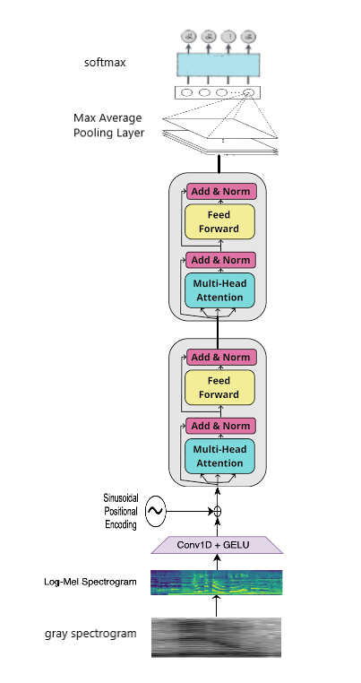

# Spoken Digit Classification with Transformers

A deep learning project exploring spoken digit recognition using a combination of 1D convolutional layers and Transformer encoders, with additional experiments investigating robustness to noise.

## Project Overview

The goal of this project is to classify spoken digits (0–9) from audio-derived spectrogram features using deep learning.

Two related experiments are included:

### 1. Baseline Spoken Digit Classification

Implementation of a Conv1D–Transformer architecture for spoken digit recognition, including feature extraction, positional encoding, Transformer-based sequence modeling, and multiclass classification.

### 2. Noise-Augmented Training

An extension of the baseline experiment investigating whether injecting noise into training data can improve the model's robustness when classifying noisy audio.

## Model Architecture



## Key Techniques

- Spectrogram-based audio representation
- Conv1D feature extraction
- Positional encoding
- Transformer encoder with multi-head self-attention
- Data augmentation
- Multiclass classification
- Confusion matrix and performance evaluation
- Evaluation under different signal-to-noise ratios (SNRs)

## Dataset

The experiments use the Free Spoken Digit Dataset (FSDD), containing recordings of spoken digits from 0 to 9.

Dataset: [Free Spoken Digit Dataset on GitHub](https://github.com/Jakobovski/free-spoken-digit-dataset)

## Technologies

- Python
- TensorFlow / Keras
- NumPy
- Matplotlib
- Scikit-learn
- Jupyter Notebook

## Repository Structure

```text
spoken-digit-classification-transformer/
├── README.md
├── spoken_digit_transformer.ipynb
├── spoken_digit_transformer_noise_augmented.ipynb
└── assets/
    └── model_architecture.png
```

## Results

Quantitative results for both experiments will be documented after evaluation, including classification performance and robustness under noisy conditions.

## Limitations

Performance may depend on the dataset split, preprocessing choices, augmentation strategy, and noise conditions. Comparisons between experiments should use consistent evaluation data and procedures.

## Learning Outcomes and Methodological Limitations

This project was developed as part of our undergraduate deep learning coursework. Beyond implementing a Conv1D–Transformer model for spoken digit classification, the experiments provided practical lessons about data preprocessing, evaluation methodology, and the challenges of building robust machine learning systems.

### Key Learning: Data Leakage

One important limitation identified during review concerns the order of data augmentation and dataset splitting. In the original workflow, spectrograms were augmented before the training, validation, and test sets were separated. As a result, augmented versions of the same original recording could potentially appear in different subsets.

This creates a risk of **data leakage**, because the model may encounter highly similar examples during training and evaluation. Consequently, the reported test performance may overestimate how well the model generalizes to genuinely unseen recordings.

A more rigorous approach would be to split the original recordings first, then apply augmentation exclusively to the training set, while keeping validation and test data independent of the augmentation process.

### Other Lessons

- **Evaluation matters as much as model architecture.** A strong-looking accuracy score is only meaningful when the evaluation protocol reliably measures generalization.
- **Robustness requires careful testing.** Experiments with additive noise and different signal-to-noise ratios help investigate how performance changes under degraded input conditions.
- **Reproducibility is essential.** Data splitting, random seeds, preprocessing choices, and experimental configurations should be documented to make results interpretable and repeatable.
- **Limitations are opportunities for improvement.** Identifying weaknesses in an earlier implementation helps guide better experimental design in future projects.

### Scope of the Results

The notebooks are preserved as coursework experiments and are presented for learning and demonstration purposes.

## Acknowledgements

This project was developed as part of undergraduate coursework in deep learning.
